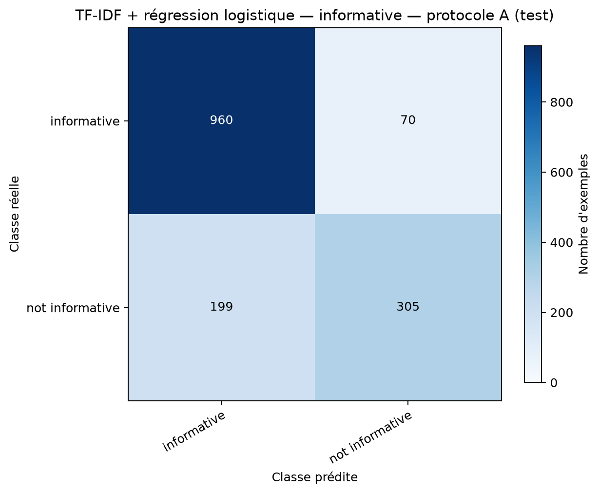
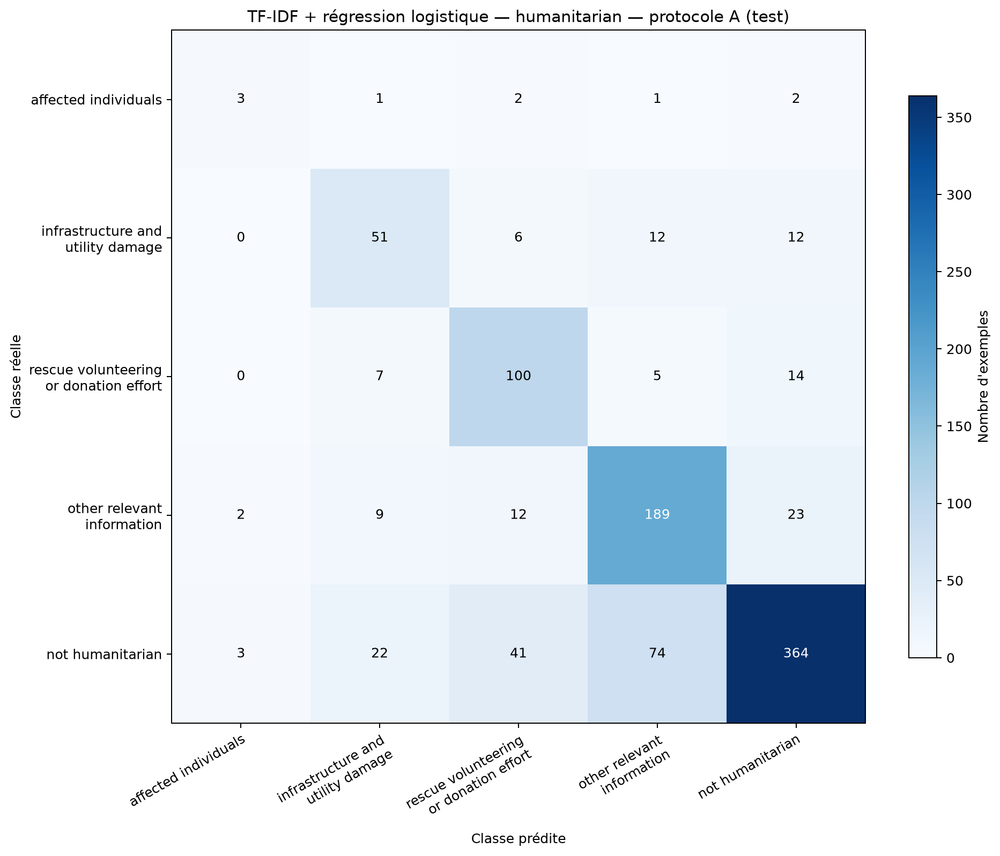

# Baseline TF-IDF + régression logistique — protocole A

Rapport reconstruit le 15 novembre 2026 depuis les résultats et le notebook sauvegardés. Aucun modèle entraîné, chargé ou réexécuté pendant la reconstruction. Les valeurs des tableaux sont arrondies à six décimales ; les CSV/JSON cités conservent la précision enregistrée.

## 1. Sources et protocole

Références : PROJET.md §§3–6 ; [notebook A](../notebooks/02_baseline_tfidf.ipynb) ; results/tables/tfidf_A_run_config.json, tfidf_A_summary.csv, tfidf_A_dev_metrics.json et les deux tableaux de validation. Les prédictions officielles sont results/predictions/{task}_tfidf_A_official.csv ; les métriques correspondantes sont results/metrics/{task}_tfidf_A_official.json.

Les deux tâches sont traitées séparément. get_split(task, "A", "official", text_only=True) déduplique seulement le train : 8 293 tweets en informative, 5 263 en humanitarian. Dev et test gardent leurs lignes officielles (1 573/1 534 et 998/955). Le test n’est pas utilisé pour sélectionner C. Le notebook garde le modèle déjà entraîné sur train et ne réentraîne pas sur train+dev.

## 2. Configuration et justification

TF-IDF unigrammes et bigrammes : ngram_range=(1,2), paramètres sklearn par défaut par ailleurs. Le vocabulaire et les IDF sont ajustés uniquement sur train. Le texte source ne subit aucune normalisation supplémentaire ; le vectoriseur applique notamment ses minuscules, sa tokenisation standard et sa normalisation L2.

Régression logistique : L2, class_weight=balanced pour tenir compte du déséquilibre, solver=lbfgs, max_iter=2000, tol=1e-4, random_state=42. Le notebook limite les opérations numériques à un thread et bloque en cas de ConvergenceWarning. Ces choix correspondent à la configuration sauvegardée :

```json
{
  "class_weight": "balanced",
  "solver": "lbfgs",
  "penalty": "l2",
  "max_iter": 2000,
  "tol": 0.0001,
  "random_state": 42
}
```

Grille fixée avant entraînement : [0.01, 0.1, 1.0, 10.0, 100.0]. Elle explore plusieurs intensités de régularisation L2. Sélection au maximum du F1 macro dev ; égalité exacte départagée par le plus petit C. Aucune extension de grille après lecture du test.

Versions enregistrées :

```json
{
  "python": "3.11.2",
  "numpy": "2.4.6",
  "pandas": "3.0.6",
  "sklearn": "1.9.1",
  "matplotlib": "3.11.2"
}
```

Le notebook B vérifie exactement ces versions. `requirements.txt` fixe les dépendances directes ; ce manifeste n’est pas un verrouillage complet des dépendances transitives.

## 3. Validation pour chaque C

### informative

| task | C | f1_macro | f1_weighted | accuracy | iterations | selected |
|---|---|---|---|---|---|---|
| informative | 0.010000 | 0.730140 | 0.767822 | 0.774952 | 3 | False |
| informative | 0.100000 | 0.748760 | 0.783458 | 0.789574 | 7 | False |
| informative | 1.000000 | 0.770613 | 0.804941 | 0.814367 | 11 | True |
| informative | 10.000000 | 0.762877 | 0.800740 | 0.814367 | 30 | False |
| informative | 100.000000 | 0.762961 | 0.801481 | 0.816275 | 18 | False |

C retenu : **1** ; F1 macro dev : **0.770613** ; vocabulaire : **109673** variables.

### humanitarian

| task | C | f1_macro | f1_weighted | accuracy | iterations | selected |
|---|---|---|---|---|---|---|
| humanitarian | 0.010000 | 0.508064 | 0.637122 | 0.617234 | 6 | False |
| humanitarian | 0.100000 | 0.508836 | 0.652180 | 0.634269 | 17 | False |
| humanitarian | 1.000000 | 0.555316 | 0.691109 | 0.680361 | 54 | False |
| humanitarian | 10.000000 | 0.606684 | 0.738731 | 0.732465 | 88 | False |
| humanitarian | 100.000000 | 0.622650 | 0.747273 | 0.742485 | 96 | True |

C retenu : **100** ; F1 macro dev : **0.622650** ; vocabulaire : **75753** variables.

## 4. Résultats test sauvegardés

| task | model | protocol | fold | selected_C | dev_f1_macro | test_rows | f1_macro | f1_macro_ci95_lower | f1_macro_ci95_upper | f1_weighted | accuracy |
|---|---|---|---|---|---|---|---|---|---|---|---|
| informative | tfidf | A | official | 1.000000 | 0.770613 | 1534 | 0.785542 | 0.762753 | 0.806893 | 0.816941 | 0.824641 |
| humanitarian | tfidf | A | official | 100.000000 | 0.622650 | 955 | 0.634204 | 0.565392 | 0.694341 | 0.744188 | 0.740314 |

Le notebook prévoit une seule inférence test predict_proba par tâche après verrouillage des choix. Les classes prédites viennent de model.classes_ ; les probabilités sont réordonnées selon LABELS[task] avant write_predictions. evaluate_file valide la population et écrit les métriques. La reconstruction n’a pas relancé cette inférence.

IC95 : bootstrap percentile ordinaire de 1 000 rééchantillonnages de paires vérité/prédiction, seed 42, univers des classes fixé par tâche, zero_division=0. Ces IC ne mesurent pas la variabilité entre seeds.

## 5. Résultats par classe et matrices de confusion

### informative

| label | precision | recall | f1-score | support |
|---|---|---|---|---|
| informative | 0.828300 | 0.932039 | 0.877113 | 1030 |
| not_informative | 0.813333 | 0.605159 | 0.693970 | 504 |

Matrice : lignes = vraies classes ; colonnes = classes prédites ; ordre LABELS[task].

| y_true | informative | not_informative |
|---|---|---|
| informative | 960 | 70 |
| not_informative | 199 | 305 |



### humanitarian

| label | precision | recall | f1-score | support |
|---|---|---|---|---|
| affected_individuals | 0.375000 | 0.333333 | 0.352941 | 9 |
| infrastructure_and_utility_damage | 0.566667 | 0.629630 | 0.596491 | 81 |
| rescue_volunteering_or_donation_effort | 0.621118 | 0.793651 | 0.696864 | 126 |
| other_relevant_information | 0.672598 | 0.804255 | 0.732558 | 235 |
| not_humanitarian | 0.877108 | 0.722222 | 0.792165 | 504 |

Matrice : lignes = vraies classes ; colonnes = classes prédites ; ordre LABELS[task].

| y_true | affected_individuals | infrastructure_and_utility_damage | rescue_volunteering_or_donation_effort | other_relevant_information | not_humanitarian |
|---|---|---|---|---|---|
| affected_individuals | 3 | 1 | 2 | 1 | 2 |
| infrastructure_and_utility_damage | 0 | 51 | 6 | 12 | 12 |
| rescue_volunteering_or_donation_effort | 0 | 7 | 100 | 5 | 14 |
| other_relevant_information | 2 | 9 | 12 | 189 | 23 |
| not_humanitarian | 3 | 22 | 41 | 74 | 364 |



## 6. Interprétation et limites

Le F1 macro est la métrique principale du projet ; le F1 pondéré et l’accuracy sont fournis séparément. Les références de littérature du projet ne servent pas à choisir les hyperparamètres. Aucun autre modèle du projet n’est déclaré entraîné dans ce rapport.

affected_individuals comporte seulement 9 exemples test ; son score dépend de quelques décisions. Le meilleur C humanitarian est la borne supérieure 100 de la grille ; cela ne démontre pas un optimum en dehors de la grille explorée. Il est conservé sans recherche supplémentaire après observation du test.

Les seuls résultats sauvegardés ici ne suffisent pas à quantifier un écart train/dev ou à établir le mécanisme d’un éventuel surapprentissage. Aucun score train, coefficient causal, temps d’apprentissage ou variation entre seeds n’est inventé.

## 7. Contrôles et reproduction

Les deux métriques test ont été contrôlées contre les prédictions et les populations officielles ; les scores, matrices, résultats par classe et IC concordent exactement en mémoire avec compute_metrics. Les deux C sélectionnés concordent avec les maxima des tableaux dev. Les manifestes de tests et d’exécution conservent les contrôles historiques ; aucun entraînement n’a été relancé pour ce document.

Pour une future reproduction autorisée, ouvrir notebooks/02_baseline_tfidf.ipynb avec le kernel .venv et exécuter de haut en bas. Cela entraîne les candidats et réécrit les sorties A ; ce n’est pas nécessaire pour lire ce rapport. La méthode de calcul est exclusivement celle de src/evaluate.py.

## 8. Livrables et provenance documentaire

- Configuration, versions, entrées et choix : results/tables/tfidf_A_run_config.json.
- Résultats dev par C : results/tables/{task}_tfidf_A_validation.csv ; détail : tfidf_A_dev_metrics.json.
- Synthèse : results/tables/tfidf_A_summary.csv.
- Prédictions et JSON test : results/predictions/ et results/metrics/, noms {task}_tfidf_A_official.
- Supports, métriques par classe et matrices CSV : results/tables/{task}_tfidf_A_official_*.csv.
- Matrices PNG : figures/{task}_tfidf_A_official_confusion_matrix.png.
- Vérifications historiques : results/tables/tfidf_A_execution_checks.json.

Cette reconstruction ne garantit pas le texte ni l’empreinte exacte du rapport historique disparu. Les anciens manifestes ne sont pas modifiés ; leurs empreintes historiques ne doivent pas être interprétées comme celles de ce nouveau texte.
